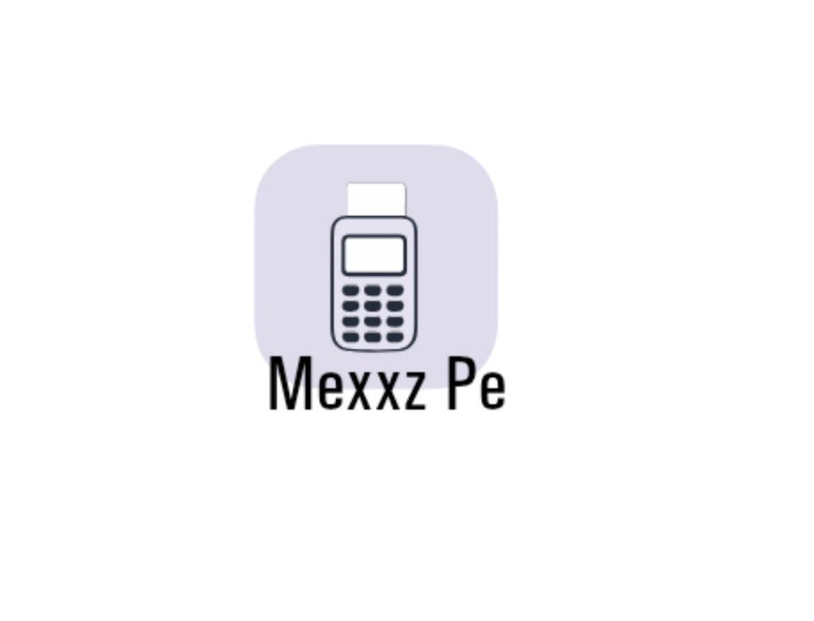

<div align="center">



# 💳 MexxzPe Business & UPI Validator
### *Automated UPI Transaction Verification & Merchant Assistant*


<p align="center">
  An automated Android application built for merchants and businesses to instantly verify UPI payments via real-time notification listeners and SMS intent validation.
</p>

---

</div>

## 🌟 Overview

**MexxzPe** streamlines merchant payment workflows by listening to incoming transaction notifications and SMS confirmations from supported UPI providers (including Paytm, PhonePe, and Google Pay). It automates payment detection, minimizing manual confirmation delays at checkout terminals.

---

## âš¡ Core Capabilities

- 🔔 **Instant Payment Hooking**: Parses incoming push notifications and SMS triggers in real-time to confirm transaction status.
- 📲 **Native UPI Deep-Linking**: Seamlessly integrates with Paytm and other installed UPI payment apps on the device.
- 📦 **Pre-Compiled Production APK**: Includes ready-to-install `MexxzPe-v4.0-MexxzPeBusiness.apk` inside the repository.
- 🛡️ **Autonomous Settlement Logs**: Tracks transaction history with payment timestamps and verification status.

---

## 📲 Installation & Setup

1. **Download APK**: Grab `MexxzPe-v4.0-MexxzPeBusiness.apk` directly from this repository or Releases.
2. **Device Requirements**: 
   - Android 8.0+
   - Active UPI application installed (e.g. Paytm, PhonePe)
3. **Permissions**: Grant Notification Access when prompted to enable real-time payment listener capabilities.

---

## 🏗️ Building from Source

```bash
# Clone the repository
git clone https://github.com/mexxz-01/upi-payment-app.git
cd upi-payment-app

# Build debug APK with Gradle wrapper
./gradlew assembleDebug
```

---

<div align="center">
  <sub>Crafted with ❤️ by <a href="https://github.com/mexxz-01">mexxz-01</a></sub>
</div>